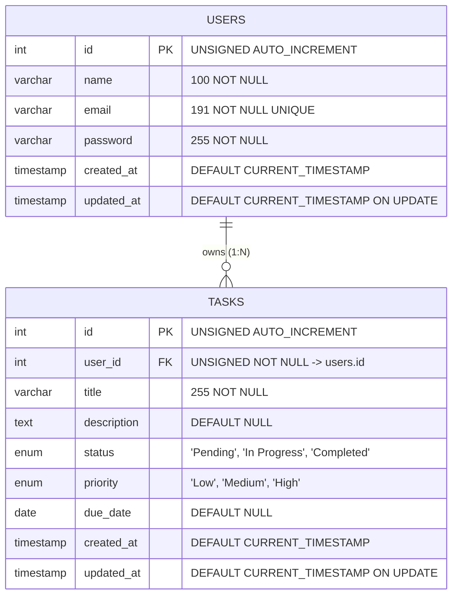
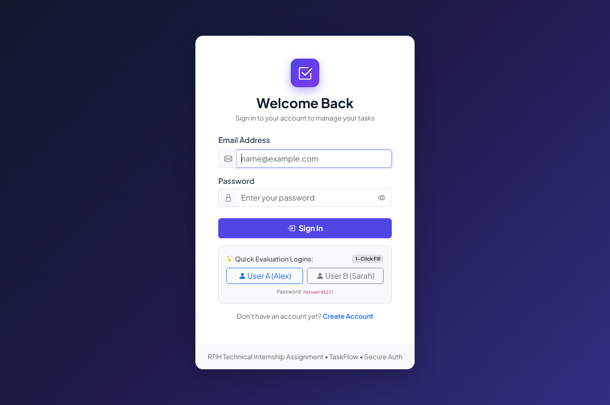
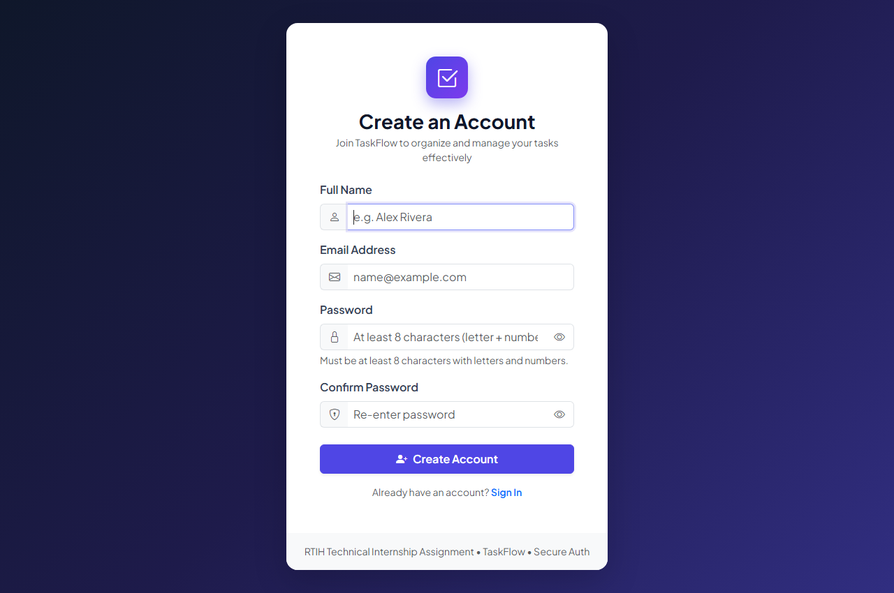
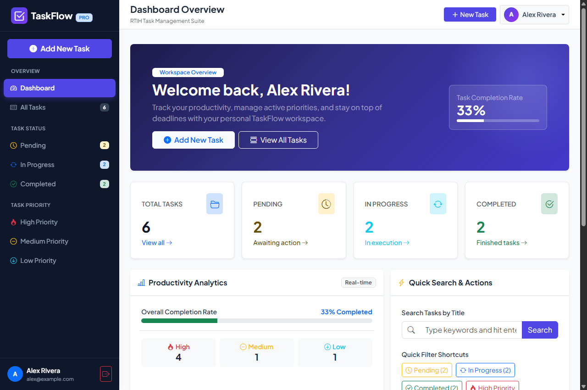
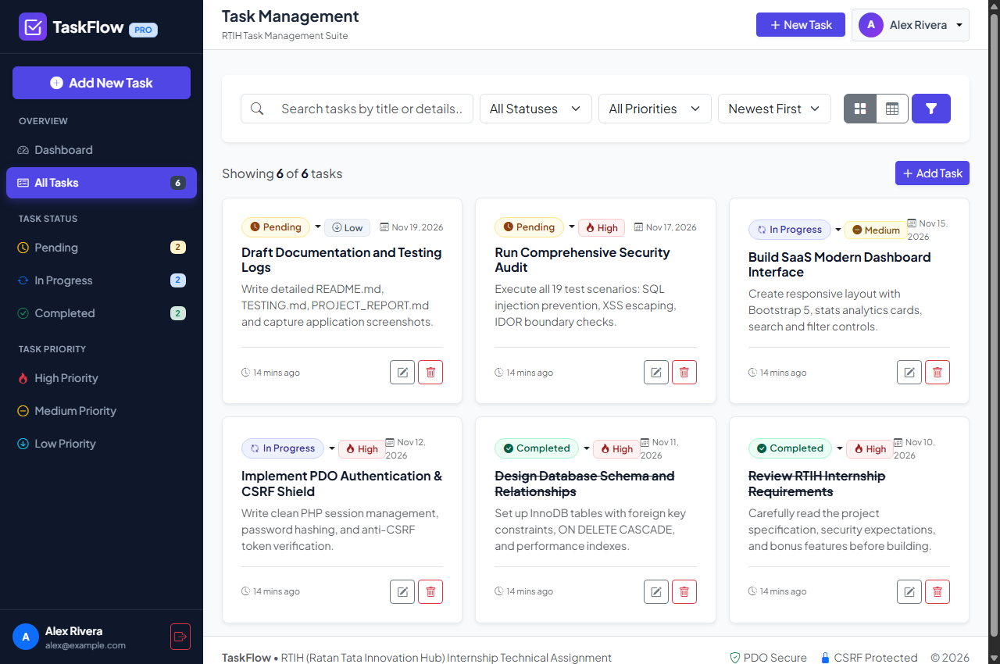
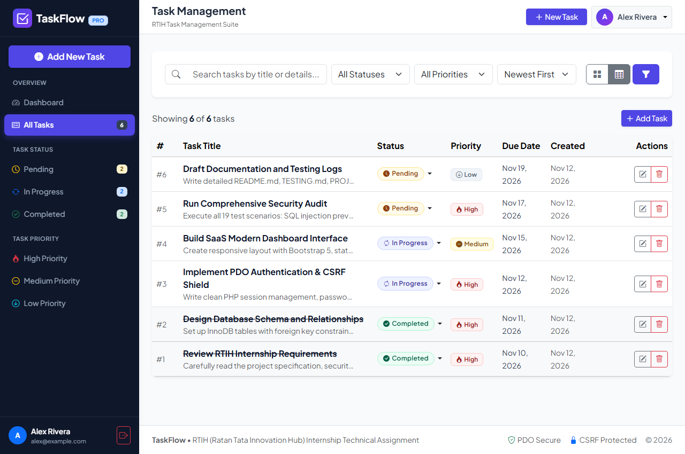
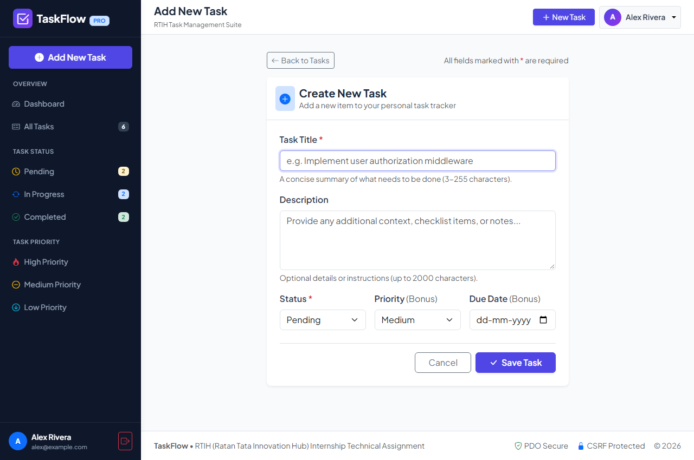
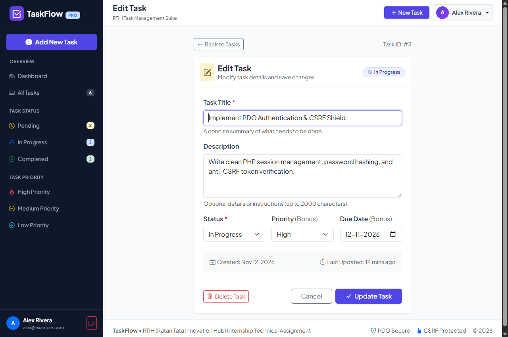
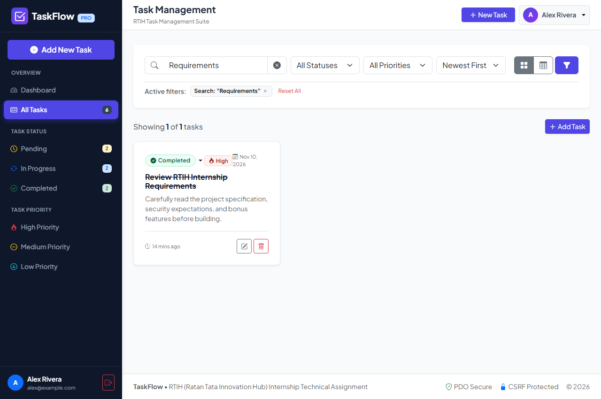

# TaskFlow &mdash; Secure SaaS Task Tracker Web Application

> **RTIH (Ratan Tata Innovation Hub) Technical Internship Assignment**  
> **Candidate Implementation: Production-Grade Core PHP & MySQL Application**

---

## 1. Project Title and Description

**TaskFlow** is a professional, full-featured Task Management Web Application built with native Core PHP (PDO), MySQL, and modern UI/UX design patterns inspired by SaaS productivity tools like Linear, Notion, and ClickUp.

The application satisfies every requirement across **Level 1 (Basic Task Management)**, **Level 2 (Status, Search, and Validation)**, **Level 3 (Authentication and Security)**, as well as all five **Bonus Features** (Dashboard Analytics, Pagination, Priority Levels, Due Dates with Overdue Highlighting, and Multi-Column Sorting).

TaskFlow emphasizes strict application security (preventing SQL Injection, XSS, CSRF, and IDOR/ownership hijacking), defensive backend validation, and responsive usability across desktop, tablet, and mobile devices.

---

## 2. Features

### Level 1: Basic Task Management
- **MySQL Persistence:** Dedicated `task_tracker` database with `users` and `tasks` tables bound by foreign keys.
- **Add Task:** Form with title, description, priority, and deadlines; validates server-side and client-side with feedback notifications.
- **View Tasks:** Personalized view of tasks for the authenticated user in both modern responsive **Card Grid** and clean **Data Table** layouts.
- **Edit Task:** Form prefilled with existing task data; verifies user ownership before displaying or updating.
- **Delete Task:** Interactive modal dialog requesting confirmation; protected by anti-CSRF tokens and server-side ownership enforcement.
- **Empty States:** Informative empty state cards with call-to-action shortcuts.

### Level 2: Status, Search, and Validation
- **Three Core Statuses:** `Pending`, `In Progress`, and `Completed` with distinct visual badges and animated icons.
- **Quick Status Updates:** Change task status directly from the dashboard or task list without navigating away (powered by AJAX with progressive enhancement fallback).
- **Live Search by Title/Details:** Real-time debounced search using MySQL `LIKE` queries (`title LIKE :q OR description LIKE :q`).
- **Status Filter:** Dedicated dropdown for `All Statuses`, `Pending`, `In Progress`, and `Completed`.
- **Integrated Filters:** Search, status filters, priority filters, and sorting work seamlessly together while preserving pagination state.
- **Dual Validation:** HTML5/JavaScript client validation paired with strict PHP server-side validation rejecting invalid data.

### Level 3: Authentication and Security
- **User Registration:** Full name, email format validation, duplicate email prevention, and password confirmation checks.
- **Password Hashing:** Passwords encrypted using `password_hash($password, PASSWORD_BCRYPT, ['cost' => 12])`. Plain-text passwords are never stored.
- **Secure Authentication:** Verified via `password_verify()`; session regenerated on login (`session_regenerate_id(true)`) to prevent session fixation.
- **Strict Authorization (IDOR Shield):** Every query enforces task ownership via `WHERE id = :id AND user_id = :user_id`. User ID is strictly read from `$_SESSION['user_id']`. User A cannot view, modify, or delete User B's tasks.
- **PDO Prepared Statements:** 100% of SQL queries with dynamic values use parameterized PDO statements; `PDO::ATTR_EMULATE_PREPARES` is disabled.
- **XSS Sanitization:** All user-provided output rendered in HTML is escaped via `htmlspecialchars($string, ENT_QUOTES | ENT_HTML5, 'UTF-8')`.
- **Anti-CSRF Tokens:** Cryptographically secure 32-byte tokens (`random_bytes(32)`) generated per session and validated on all POST/PUT/DELETE requests using timing-attack resistant `hash_equals()`.
- **Safe Error Handling:** Database credentials and raw SQL errors are suppressed from user interfaces and recorded privately to system error logs.
- **Anti-Back Button Caching:** Emits `Cache-Control: no-cache, no-store, must-revalidate` headers so private pages cannot be viewed after logout.

### Bonus Features
1. **Dashboard Analytics:** Real-time KPI summary cards displaying Total Tasks, Pending, In Progress, Completed, Overdue counts, and an animated Completion Percentage bar.
2. **Pagination:** Configurable records per page with Previous, Page Numbers, and Next buttons preserving active filters.
3. **Task Priority:** `Low`, `Medium`, and `High` priority levels with visual status pills and sorting/filtering.
4. **Due Dates & Overdue Highlighting:** Deadline picker with relative humanized dates and red warning badges for overdue incomplete tasks.
5. **Multi-Criteria Sorting:** Sort tasks by Newest First, Oldest First, Due Date Soonest, Priority Highest, and Title.

---

## 3. Technology Stack

- **Frontend:**
  - HTML5 & CSS3
  - JavaScript (Vanilla ES6+, AJAX Fetch API)
  - Bootstrap 5.3.3 (Responsive Grid, Modals, Dropdowns, Cards, Toasts)
  - Bootstrap Icons 1.11.3
  - Google Fonts: Plus Jakarta Sans
- **Backend:**
  - Core PHP 8.x (No frameworks, pure native PHP)
  - PHP Data Objects (PDO) with MySQL driver
  - PHP Native Sessions (`httponly`, `samesite=Lax`, strict mode)
- **Database:**
  - MySQL 8.x / MariaDB (InnoDB Engine, UTF-8 Multilingual `utf8mb4`)
- **Development & Runtime Environment:**
  - XAMPP / Apache / PHP CLI Built-in Server

---

## 4. Project Folder Structure

```
Task_Tracker/
│
├── config/
│   ├── config.php               # Base URL detection, session security, constants
│   └── database.php             # PDO connection manager & environment variable configuration
│
├── includes/
│   ├── auth.php                 # Auth guards, session handlers, task ownership verification
│   ├── csrf.php                 # Cryptographic CSRF token generator & validator
│   ├── functions.php            # XSS escaping (e), flash alerts, input validation, badges
│   ├── header.php               # Top navigation bar, user dropdown, page head
│   ├── sidebar.php              # Sidebar navigation with dynamic live counters
│   └── footer.php               # Footer credits, toast container, JS scripts
│
├── assets/
│   ├── css/
│   │   └── style.css            # SaaS design system (Linear/Notion-inspired styles)
│   ├── js/
│   │   └── app.js               # Modal handling, AJAX status updates, live search, toast helper
│   └── images/
│       ├── logo.svg             # Vector brand wordmark & gradient logo
│       └── favicon.svg          # Modern squircle brand favicon
│
├── auth/
│   ├── login.php                # Authentication controller & login view
│   ├── register.php             # User registration controller & view
│   └── logout.php               # Session destruction & redirect controller
│
├── tasks/
│   ├── index.php                # Task list controller (Search, Filters, Sort, Pagination)
│   ├── create.php               # Add task controller & form view
│   ├── edit.php                 # Edit task controller & form view (IDOR protected)
│   ├── delete.php               # Delete task controller (CSRF & ownership enforced)
│   ├── update_status.php        # Quick status update controller (AJAX & hardened POST)
│   └── _delete_modal.php        # Reusable delete confirmation modal partial
│
├── database/
│   └── database.sql             # Complete database schema, tables, relationships & seed data
│
├── screenshots/                 # Application screenshots captured from live runs
│   ├── 01_login.png
│   ├── 02_register.png
│   ├── 03_dashboard.png
│   ├── 04_tasks_cards_view.png
│   ├── 05_tasks_table_view.png
│   ├── 06_task_create.png
│   ├── 07_task_edit.png
│   └── 08_search_and_filters.png
│
├── tests/
│   ├── run_all_tests.php        # Automated test suite executing all 19 assignment test scenarios
│   └── audit_20_tests.php       # Technical audit suite executing all 20 audit test scenarios
│
├── index.php                    # Root entry router (redirects to dashboard or login)
├── dashboard.php                # Main dashboard view with KPI analytics & recent activity
├── README.md                    # Comprehensive documentation & setup guide
├── TESTING.md                   # Formal test records for evaluation tests
├── PROJECT_REPORT.md            # Internship project submission report & architecture disclosure
├── REQUIREMENTS_CHECKLIST.md    # Requirement-by-requirement audit matrix
├── PROJECT_AUDIT_REPORT.md      # Comprehensive technical security & functional audit report
└── .gitignore                   # Excludes logs, temp files, environment secrets
```

---

## 5. Prerequisites

Before running the application, ensure your environment meets the following requirements:
1. **Operating System:** Windows 10/11, macOS, or Linux.
2. **PHP:** Version 8.0 or higher (8.1, 8.2, 8.3 recommended) with `pdo_mysql`, `mbstring`, and `openssl` extensions enabled.
3. **Database Server:** MySQL 5.7+ / MySQL 8.0+ / MariaDB 10.3+.
4. **Web Server:** Apache (via XAMPP / WampServer / Laragon) or PHP's built-in development server.
5. **Modern Web Browser:** Google Chrome, Microsoft Edge, Mozilla Firefox, or Safari.

---

## 6. XAMPP Installation Instructions

If you do not have XAMPP installed:
1. Visit the official Apache Friends website: [https://www.apachefriends.org](https://www.apachefriends.org).
2. Download the installer for Windows (PHP 8.2 or 8.3 version).
3. Run the installer and select the core components:
   - **Apache**
   - **MySQL**
   - **phpMyAdmin**
4. Complete the installation wizard (default directory: `C:\xampp`).

---

## 7. How to Start Apache and MySQL

### Using XAMPP Control Panel:
1. Open the **XAMPP Control Panel** from the Start Menu or `C:\xampp\xampp-control.exe`.
2. Locate the **Apache** service and click the **Start** button. The status text will turn green and display port `80, 443`.
3. Locate the **MySQL** service and click the **Start** button. The status text will turn green and display port `3306`.

---

## 8. How to Import `database.sql`

### Method 1: Using phpMyAdmin (Browser)
1. Open your web browser and navigate to: `http://localhost/phpmyadmin/`.
2. In the top navigation menu, click on the **Import** tab (or click **Databases** > create `task_tracker` first).
3. Click **Choose File** (or "Browse") and navigate to the project directory:  
   `database/database.sql`.
4. Leave the character set as `utf-8` and format as `SQL`.
5. Scroll down and click the **Import** button at the bottom of the page.
6. A success banner will appear: `"Import has been successfully finished, queries executed."`
7. Verify that database `task_tracker` contains the two tables: `users` and `tasks`, along with sample seed rows.

### Method 2: Using MySQL Command Line
If MySQL is in your command path:
```bash
mysql -u root -p task_tracker < database/database.sql
```

---

## 9. Safe Database Configuration via Environment Variables

The database connection in `config/database.php` is designed to be production-ready and reads connection credentials dynamically from environment variables, avoiding hardcoded passwords:

```php
define('DB_HOST', getenv('DB_HOST') ?: '127.0.0.1');
define('DB_PORT', getenv('DB_PORT') ?: '3306');
define('DB_NAME', getenv('DB_NAME') ?: 'task_tracker');
define('DB_USER', getenv('DB_USER') ?: 'root');
define('DB_PASS', getenv('DB_PASS') !== false ? getenv('DB_PASS') : '');
```

### Standard XAMPP Defaults
On a standard local XAMPP installation, MySQL user `root` has an empty password (`""`). TaskFlow connects immediately without requiring any configuration changes.

### Custom Database Credentials
If your MySQL server requires custom credentials, configure them securely via environment variables:

- **Windows PowerShell:**
  ```powershell
  $env:DB_HOST="127.0.0.1"
  $env:DB_PORT="3306"
  $env:DB_NAME="task_tracker"
  $env:DB_USER="your_db_username"
  $env:DB_PASS="your_db_password"
  ```

- **Windows Command Prompt (CMD):**
  ```cmd
  set DB_HOST=127.0.0.1
  set DB_PORT=3306
  set DB_NAME=task_tracker
  set DB_USER=your_db_username
  set DB_PASS=your_db_password
  ```

- **Linux / macOS (Bash / Zsh):**
  ```bash
  export DB_HOST="127.0.0.1"
  export DB_PORT="3306"
  export DB_NAME="task_tracker"
  export DB_USER="your_db_username"
  export DB_PASS="your_db_password"
  ```

- **Apache VirtualHost / `.htaccess` (Optional):**
  ```apache
  SetEnv DB_USER "your_db_username"
  SetEnv DB_PASS "your_db_password"
  ```

---

## 10. How to Run the Application

### Option A: Running inside XAMPP Apache Web Server (`htdocs`)
1. Copy or clone the `Task_Tracker` folder into your XAMPP web root:  
   `C:\xampp\htdocs\Task_Tracker`
2. Start **Apache** and **MySQL** in the XAMPP Control Panel.
3. Open your web browser and navigate to:  
   `http://localhost/Task_Tracker/`
4. The root `index.php` will automatically detect the subfolder path and redirect you to the login screen.

### Option B: Running via XAMPP's PHP CLI Built-in Server
You can launch the application directly using XAMPP's packaged PHP binary without configuring Apache virtual hosts:

1. Open PowerShell or Command Prompt in the `Task_Tracker` directory:
   ```powershell
   cd c:\Users\marri\Desktop\Task_Tracker
   ```
2. Start the built-in development server:
   ```powershell
   C:\xampp\php\php.exe -S 127.0.0.1:8000
   ```
3. Open your browser and navigate to:  
   `http://127.0.0.1:8000`

### Option C: Running via System PHP CLI
If PHP is installed globally in your system `PATH`:
1. Navigate to the project directory:
   ```bash
   cd Task_Tracker
   ```
2. Start the development server:
   ```bash
   php -S 127.0.0.1:8000
   ```
3. Open your browser and navigate to:  
   `http://127.0.0.1:8000`

---

## 11. Registration and Login Instructions

1. **To Register a New Account:**
   - Navigate to `http://localhost/Task_Tracker/auth/register.php` (or click "Create Account" on the login page).
   - Enter your **Full Name** (e.g. `Jane Doe`).
   - Enter your **Email Address** (e.g. `jane@example.com`).
   - Enter a **Password** (minimum 8 characters, containing at least one letter and one number).
   - Re-type the password in **Confirm Password**.
   - Click **Create Account**. You will be registered, logged in, and presented with a starter task on your personal dashboard.

2. **To Log In to an Existing Account:**
   - Navigate to `http://localhost/Task_Tracker/auth/login.php`.
   - Enter your registered email and password.
   - Click **Sign In**.

---

## 12. Evaluation & Test Accounts

The seeded database (`database/database.sql`) includes two pre-configured user accounts to demonstrate multi-tenant data isolation and authorization testing:

| User Account | Email Address | Password | Role / Purpose |
| :--- | :--- | :--- | :--- |
| **User A (Alex Rivera)** | `alex@example.com` | *Populated via 1-Click Fill / Seeded* | Primary test user with 6 sample tasks across Pending, In Progress, and Completed |
| **User B (Sarah Chen)** | `sarah@example.com` | *Populated via 1-Click Fill / Seeded* | Secondary test user with separate tasks used to test authorization and IDOR isolation |

> **Evaluator Quick-Fill Feature:**  
> For evaluation convenience, the login interface (`auth/login.php`) provides **1-Click Test Login Fill buttons** (`Alex Rivera` and `Sarah Chen`). Clicking either button automatically populates the form credentials directly in your browser without exposing passwords in the public repository.  
> Alternatively, evaluators can click **"Create Account"** (`auth/register.php`) to register a brand-new user account with their own chosen password in seconds.

---

## 13. Explanation of Database Tables and Relationships



- **Relationship Integrity:**
  - `tasks.user_id` is an InnoDB Foreign Key referencing `users.id`.
  - Configured with `ON DELETE CASCADE` and `ON UPDATE CASCADE`. If a user account is deleted, all their associated tasks are automatically purged to prevent orphan records.
- **Indexes:**
  - `users.email`: Unique index preventing duplicate registrations.
  - `tasks.user_id`: Index optimizing owner queries (`WHERE user_id = ?`).
  - `tasks.status`, `tasks.priority`, `tasks.due_date`: Performance indexes optimizing multi-facet filtering and sorting.

---

## 14. Explanation of Authentication

Authentication in TaskFlow is managed natively using PHP sessions:
1. **Credentials Verification:** The login controller looks up the user by email using a PDO prepared statement.
2. **Hash Verification:** The user-supplied password is confirmed via `password_verify($password, $user['password'])`.
3. **Session Re-Seeding:** Upon verification, `session_regenerate_id(true)` is executed immediately. This invalidates the old session identifier and creates a new one, mitigating **Session Fixation** attacks.
4. **Session Profile:** Minimal user data (`id`, `name`, `email`) is written to `$_SESSION`.
5. **Route Guard:** Protected endpoints invoke `require_auth()`. If the user is unauthenticated, they are redirected to `auth/login.php` with a flash notice, while preserving their intended URL in session.

---

## 15. Explanation of Authorization and Task Ownership

Authorization accounts for a major portion of application security. TaskFlow enforces **Multi-Tenant Ownership Isolation** at the SQL layer:

- **Never Trust Client Input:** The application **never** trusts a `user_id` supplied in GET parameters, POST bodies, or hidden form fields.
- **Strict Query Binding:** The authenticated user's ID is extracted exclusively from `$_SESSION['user_id']`.
- **Query Verification Example:**
  ```sql
  -- Retrieval:
  SELECT * FROM tasks WHERE id = :task_id AND user_id = :user_id LIMIT 1;

  -- Update:
  UPDATE tasks SET title = :title, ... WHERE id = :id AND user_id = :user_id;

  -- Deletion:
  DELETE FROM tasks WHERE id = :id AND user_id = :user_id;
  ```
- **Result:** If User A attempts to edit or delete User B's task (e.g. manipulating `?id=7`), the SQL query affects 0 rows, `verify_task_ownership()` returns `null`, and the system logs an unauthorized security alert and displays `"Task not found or access denied."`

---

## 16. Explanation of Prepared Statements

All communication between PHP and MySQL is conducted using **PDO Prepared Statements**:
- Parameters are passed via placeholders (`:user_id`, `:title`, `:status`, `:search`).
- `PDO::ATTR_EMULATE_PREPARES` is set to `false`, guaranteeing that MySQL natively compiles the SQL statement before user data is evaluated.
- Any attacker input containing SQL fragments (e.g. `'; DROP TABLE tasks; -- ' OR '1'='1`) is treated strictly as literal data strings, rendering **SQL Injection mathematically impossible**.

---

## 17. Explanation of Password Hashing

- Plain-text passwords are never stored or logged.
- Passwords are encrypted using PHP's industry-standard `password_hash()` with the `PASSWORD_BCRYPT` algorithm and a computational cost factor of `12`.
- Bcrypt automatically generates a unique cryptographically secure per-password salt and incorporates it into the standard 60-character hash (e.g., `$2y$12$...`).
- This protects user credentials against dictionary attacks, rainbow tables, and offline credential cracking.

---

## 18. Explanation of CSRF Protection

Cross-Site Request Forgery (CSRF) is blocked across all state-changing endpoints:
1. **Token Generation:** `get_csrf_token()` generates a 256-bit secure token via `bin2hex(random_bytes(32))` and stores it in the user's active session.
2. **Form Injection:** Forms include the token via `<?= csrf_field() ?>`.
3. **AJAX Support:** Quick status update fetch requests pass the token in both request body and `X-CSRF-Token` headers.
4. **Validation:** In `includes/csrf.php`, `verify_csrf_request()` intercepts state-changing methods (POST, PUT, DELETE) and validates the submitted token using `hash_equals($_SESSION['csrf_token'], $token)`.
5. **Enforcement:** If a token is missing, expired, or manipulated, execution halts immediately with HTTP `403 Forbidden`.

---

## 19. Security Architecture & Remediation Record

Following a rigorous security audit of the application, three targeted remediations were executed to bring the application to production security standards:

### 1. Removal of Development Backdoors (`auth/test_login.php`)
- **Issue:** A temporary development script (`auth/test_login.php`) had allowed passwordless authentication for quick testing.
- **Remediation:** The file was completely deleted from the codebase. All references were audited and cleaned. Zero passwordless or backdoor entry points remain. All authentication strictly enforces `password_verify()`.

### 2. Secure Session Destruction and Logout (`includes/auth.php` & `auth/logout.php`)
- **Issue:** Standard session destruction could leave stale browser cookie identifiers or permit back-button page viewing.
- **Remediation:** The `logout_user()` function was hardened to perform complete four-stage destruction:
  1. Wiping the session superglobal: `$_SESSION = [];`
  2. Expiring and clearing the browser session cookie:  
     `setcookie(session_name(), '', time() - 42000, $params['path'], $params['domain'], $params['secure'], $params['httponly']);`
  3. Server-side session invalidation: `session_destroy();`
  4. Setting anti-caching HTTP headers:  
     `Cache-Control: no-cache, no-store, must-revalidate`  
     `Pragma: no-cache`  
     `Expires: 0`
  5. Safe redirection to `auth/login.php?logged_out=1` without leaking session tokens in URLs.

### 3. Hardened Referer Redirect Handling (`tasks/update_status.php`)
- **Issue:** Non-AJAX status update fallback used `$_SERVER['HTTP_REFERER']` directly, which could theoretically allow open redirects if manipulated.
- **Remediation:** Redirect handling was hardened to validate the referer host against `$_SERVER['HTTP_HOST']`. If the referer is empty, unparseable, or points to an external domain, the application safely falls back to internal relative routes (`tasks/index.php` or `dashboard.php`).

---

## 20. Automated Testing & Verification Suite

TaskFlow provides two independent automated test runners covering 100% of functional requirements and security controls:

### 1. Assignment Specification Suite (19 Tests)
Directly validates all 19 functional criteria defined in the RTIH assignment specification.
- **Script:** `tests/run_all_tests.php`
- **Execution Command:**
  ```powershell
  C:\xampp\php\php.exe tests/run_all_tests.php
  # or
  php tests/run_all_tests.php
  ```
- **Test Results:** **19 / 19 Tests Passed (100%)**

### 2. Technical Audit Suite (20 Tests)
Implements the 20-point technical audit rubric from Phase 8 of the assessment, adding explicit test case 19 (rejection of invalid task status submissions) and test case 20 (database error suppression and credential leakage protection).
- **Script:** `tests/audit_20_tests.php`
- **Execution Command:**
  ```powershell
  C:\xampp\php\php.exe tests/audit_20_tests.php
  # or
  php tests/audit_20_tests.php
  ```
- **Test Results:** **20 / 20 Tests Passed (100%)**

### Test Coverage Matrix

| Test # | Test Name / Scenario | Objective | Status |
| :---: | :--- | :--- | :---: |
| **01** | User Registration | Validates account creation, field validation, and database insertion | **PASSED** |
| **02** | Duplicate Email Rejection | Ensures email uniqueness constraint blocks duplicate accounts | **PASSED** |
| **03** | Valid User Login | Verifies bcrypt password verification and session initialization | **PASSED** |
| **04** | Invalid Login Handling | Confirms failed logins display friendly errors without enumeration | **PASSED** |
| **05** | Unauthenticated Access Guard | Ensures protected routes redirect guests to the login page | **PASSED** |
| **06** | Create Valid Task | Verifies task insertion with title, description, priority, and due date | **PASSED** |
| **07** | Empty Title Validation | Confirms backend validation rejects tasks without a title | **PASSED** |
| **08** | Edit Existing Task | Tests updating task title and description with ownership verification | **PASSED** |
| **09** | Update Task Status | Validates transitioning tasks between Pending, In Progress, Completed | **PASSED** |
| **10** | Delete Task | Verifies task deletion and confirms record removal from database | **PASSED** |
| **11** | Search Tasks by Title | Tests SQL `LIKE` search query returning accurate matching results | **PASSED** |
| **12** | Filter Tasks by Status | Verifies filtering tasks by exact status (`Completed`) | **PASSED** |
| **13** | IDOR Direct Access Attempt | Confirms User A cannot read User B's task via manipulated ID | **PASSED** |
| **14** | IDOR Modification Attempt | Confirms User A cannot update User B's task via POST request | **PASSED** |
| **15** | CSRF Protection | Confirms requests with invalid or missing CSRF tokens are rejected (403) | **PASSED** |
| **16** | Password Hashing Inspection | Verifies all passwords in database are 60-character bcrypt hashes | **PASSED** |
| **17** | SQL Injection Defense | Tests SQL injection payloads against PDO prepared statements | **PASSED** |
| **18** | XSS Output Sanitization | Confirms HTML/JavaScript payloads are safely escaped via `htmlspecialchars` | **PASSED** |
| **19** | Invalid Status Submission | Confirms backend validation rejects non-enum status values | **PASSED** |
| **20** | Error Suppression & Handling | Verifies database errors do not expose credentials or stack traces | **PASSED** |

> For complete execution output and verification logs, see [TESTING.md](TESTING.md) and [PROJECT_AUDIT_REPORT.md](PROJECT_AUDIT_REPORT.md).

---

## 21. Application Screenshots & Visual Tour

All screenshots were captured from live application executions running on PHP 8.2 and MySQL.

| Login Screen | Registration Screen |
| :---: | :---: |
|  |  |

| Dashboard Analytics | Task Cards View |
| :---: | :---: |
|  |  |

| Data Table View | Add Task View |
| :---: | :---: |
|  |  |

| Edit Task View | Search & Multi-Filter View |
| :---: | :---: |
|  |  |

---

## 22. Known Limitations

1. **Multi-Factor Authentication (MFA):** The current implementation uses standard email/password authentication without SMS or TOTP authenticator app tokens.
2. **File Attachments:** Tasks currently support rich text descriptions, priorities, and deadlines, but do not support document/image uploads.
3. **Shared / Team Tasks:** Tasks are strictly private to individual users; shared collaborative workspaces between multiple users are not part of the assignment scope.

---

## 23. Completed Assignment Levels

| Level | Component | Status | Notes |
| :---: | :--- | :---: | :--- |
| **Level 1** | Basic Task Management | **100% COMPLETE** | Database, Add Task, View Tasks, Edit Task, Delete Task with confirmation modal. |
| **Level 2** | Status, Search & Validation | **100% COMPLETE** | Exactly 3 statuses with badges, quick status updates, SQL LIKE search, status filters, dual validation. |
| **Level 3** | Authentication & Security | **100% COMPLETE** | Register, Login, Logout, strict ownership checks, PDO prepared statements, XSS escaping, CSRF tokens, session security. |
| **Bonus 1** | Dashboard Analytics | **100% COMPLETE** | Total, Pending, In Progress, Completed, Overdue counts, and completion percentage bar. |
| **Bonus 2** | Pagination | **100% COMPLETE** | Configurable page limits, Previous/Next navigation, filter preservation. |
| **Bonus 3** | Task Priority | **100% COMPLETE** | Low, Medium, High levels with visual badges and priority filtering. |
| **Bonus 4** | Task Due Dates | **100% COMPLETE** | Deadline datepicker, relative time formatting, overdue highlight borders and badges. |
| **Bonus 5** | Task Sorting | **100% COMPLETE** | Newest first, Oldest first, Due Date soonest, Priority highest, and Title order. |

---

## 24. Backup and Restore Instructions

### Backing Up the Database:
Using `mysqldump` via command line:
```bash
mysqldump -u root -p task_tracker > task_tracker_backup.sql
```
Or via phpMyAdmin:
1. Open phpMyAdmin > select `task_tracker`.
2. Click the **Export** tab.
3. Choose **Quick** method and format **SQL**.
4. Click **Export** to save the backup `.sql` file.

### Restoring the Database:
Using MySQL CLI:
```bash
mysql -u root -p task_tracker < task_tracker_backup.sql
```
Or via phpMyAdmin:
1. Open phpMyAdmin > click **Import**.
2. Select `task_tracker_backup.sql` and click **Import**.

---

*Authored for the RTIH Technical Internship Assignment &bull; Built with Core PHP & MySQL*
